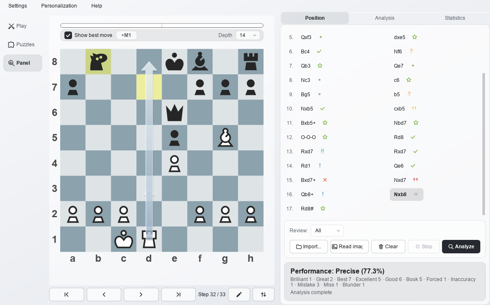
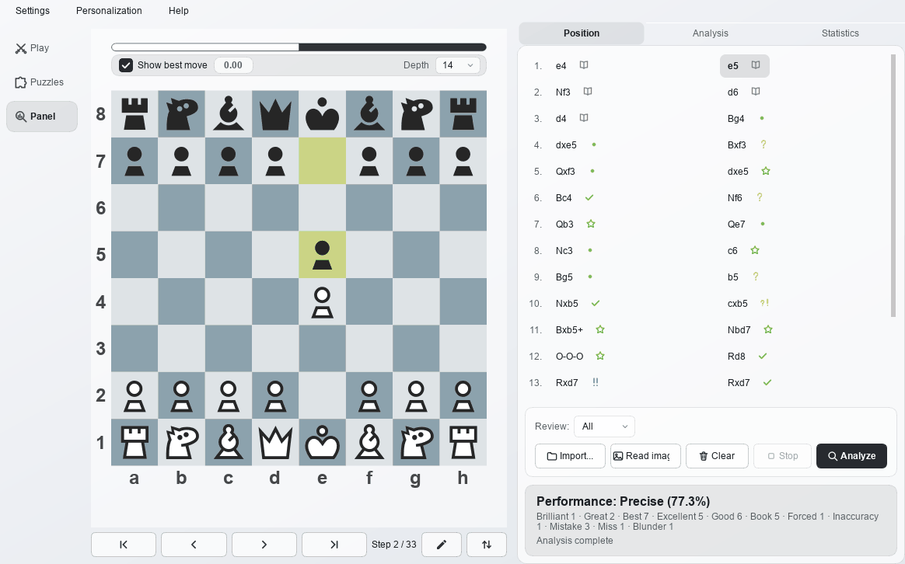
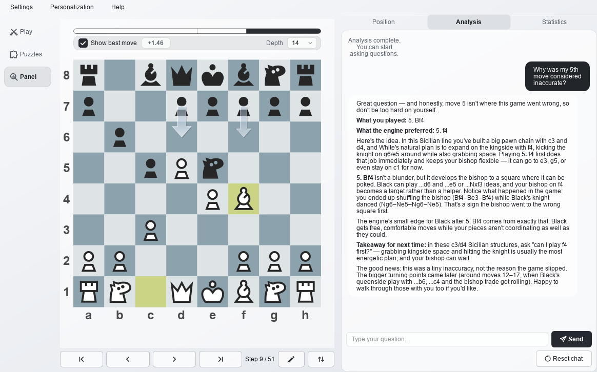
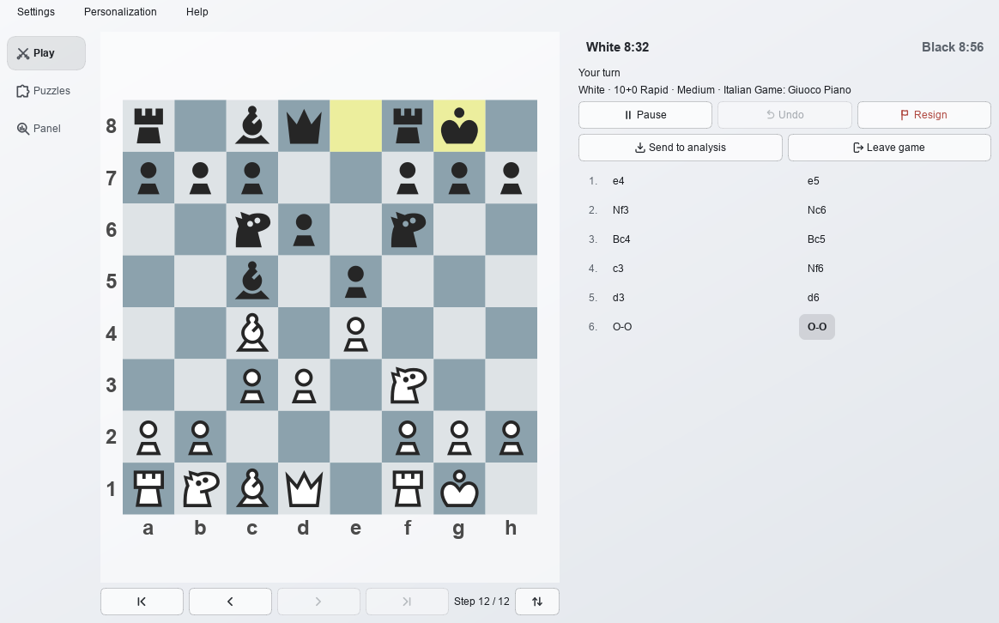
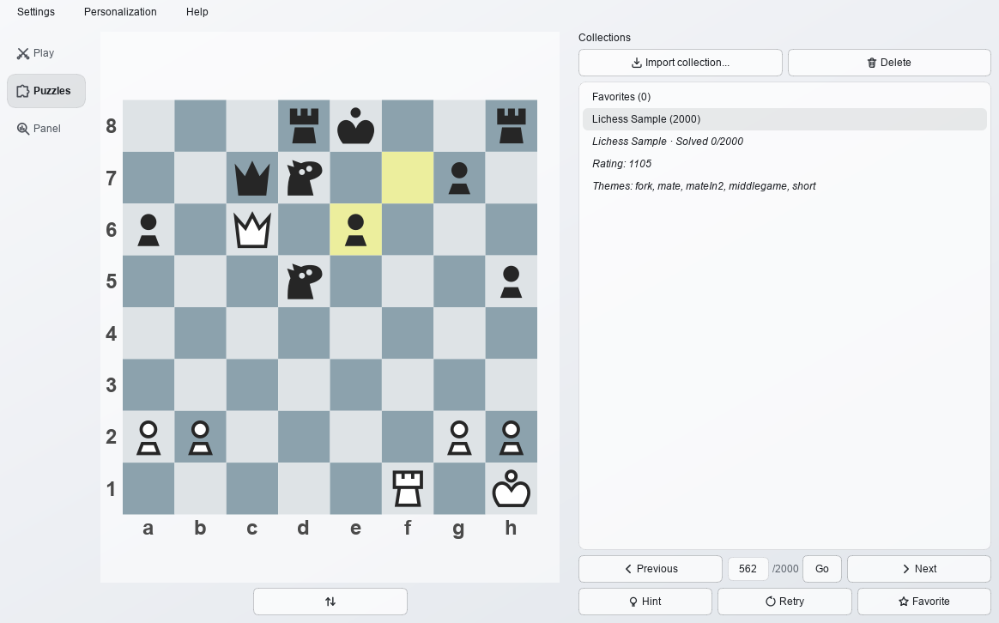
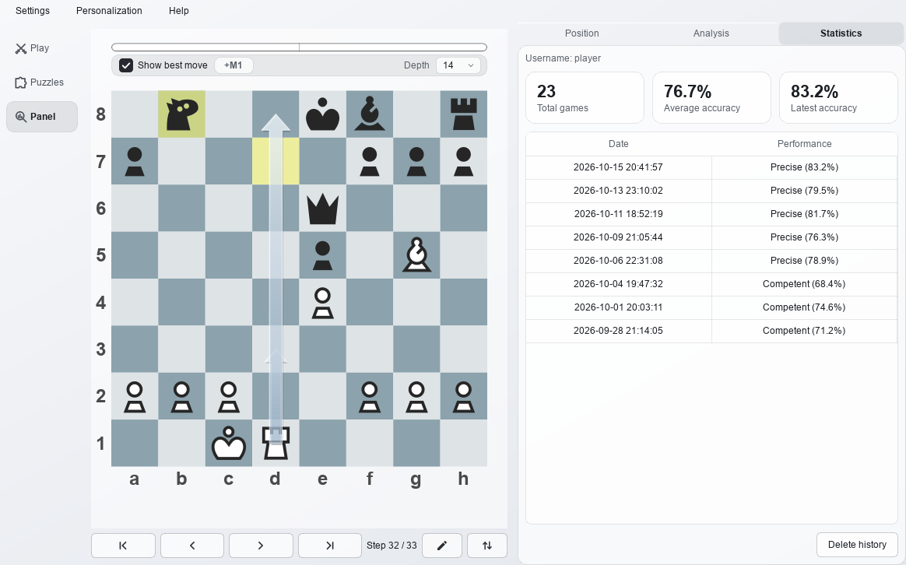
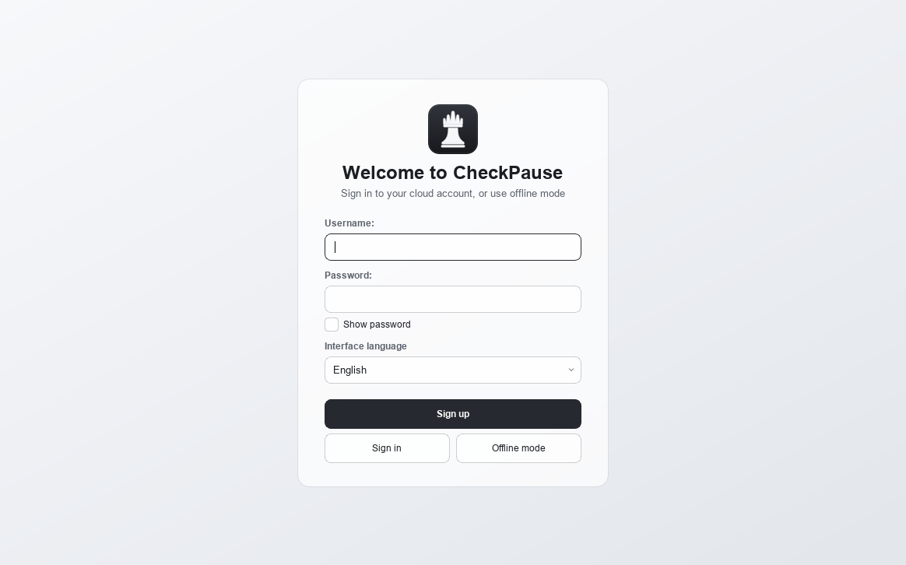

# ♟️ CheckPause

A chess analysis tool that combines game-tree search with natural language generation to help players understand their own decision-making biases.

CheckPause evaluates every move with a local Stockfish engine, then lets any OpenAI-compatible model explain the engine data in plain language, alongside a clickable move list, a custom-drawn board, performance ratings, and a personal growth profile.

---

## ✨ Features

### ♟️ Review every move like a report card

- Stockfish scores every ply in the background, with a progress bar and a stop button; book moves are recognised from the bundled Polyglot opening book and skip the engine entirely.
- Every move gets a label the way a review report does it — Brilliant, Great, Best, Excellent, Good, Book, Forced, Only move, Inaccuracy, Mistake, Miss, Blunder — and the game an accuracy rating on a five-tier scale (Optimal / Precise / Competent / Steady / Volatile).
- Click any move to jump to that position; the board draws the engine's best-move arrows, shows a live evaluation bar, and flips with one click.

### 💬 Ask the engine data in plain language

- The engine data (PGN plus per-move scores and best moves) is passed to the model as context, and answers stream in token by token.
- Follow-up questions work like a coach conversation: "Wasn't 10.Nxb5 just losing a knight?" gets an answer grounded in the numbers on screen.
- Works with DeepSeek, OpenAI, OpenRouter, or a local model — anything that speaks the OpenAI API.

### 🎮 Play the computer

- A 100–3000 rating slider; 1320 and above is calibrated by Stockfish's own Elo limiter, and below that Skill Level and a node budget approximate it.
- Common time controls (1+0 through 30+0, with increments or unlimited), White or Black, and selectable openings and endgames.
- Click-to-move, promotion picking, undo, resign — and a one-click send to analysis when the game ends. The setup pickers lock once a game is under way and unlock on New game.

### 🧩 Train with puzzles

- A curated Lichess sample ships with the app, and you can import your own open collections (Lichess CSV, or FEN-based PGN); large collections are read lazily.
- Correct/wrong feedback with automatic opponent replies, hint arrows and retry; rating and themes shown per puzzle.
- A Favorites collection automatically gathers the puzzles you star or miss.

### 📈 Watch your numbers

- Total games, average accuracy, and the latest game's accuracy at a glance.
- A per-game history table with the date, the rating tier, and the percentage.

### 🎨 Make it yours

- 10 Lichess open-source piece sets, 6 board themes, and light/dark modes, applied instantly and saved.
- Move sounds for quiet moves, captures, checks, castling and promotions, in a Default set or Off; every clip is synthesised by the project, with no third-party assets.
- A Chinese or English interface, switchable at any time; analysis depth (12–18) and evaluation depth (10–22) adjustable under Personalization.

### 🔒 Private by design

- Your games and API keys stay on your machine; analysis never depends on the cloud.

---

## 🚀 Quick Start

Requirements: Windows 10/11 (x64) or macOS 11+ (Apple Silicon or Intel). No Python needed — Stockfish, the opening book and all assets are bundled.

### Windows users

1. Get `CheckPause_Setup_2.0.2.zip` from the Download section at the end of this file, then extract it to get `CheckPause_Setup_2.0.2.exe`.
2. Run the installer and follow the prompts — no administrator rights needed, and a desktop shortcut is optional.
3. Launch CheckPause from the desktop or Start Menu; the first launch lets you sign in to a cloud account, create one, or continue offline.
4. Open Settings → API settings... and fill in the API key, base URL and model name for an OpenAI-compatible endpoint (for example DeepSeek).
5. Paste or open a PGN on the Import tab, click Analyze, then ask questions on the Analysis tab.

> Analysis and board features work without an API key; only AI chat needs one.

### macOS users

1. Download the `.dmg` for your chip from the [Releases](https://github.com/Comet-zzz/CheckPause/releases) page (`M-series` for Apple Silicon, `Intel` for Intel Macs).
2. Open the `.dmg` and drag CheckPause into Applications.
3. The build is unsigned and not notarized. On first launch, **right-click the icon → Open**, or allow it under System Settings → Privacy & Security → Open Anyway.
4. From there the steps match Windows (set an API key, import a PGN, start analysis).

---

## ⚙️ Configuration and data

- Settings → API settings... is the bring-your-own-key path: enter the API key, base URL and model name for any OpenAI-compatible service. Signing in to a cloud account switches the app to the hosted tier instead.
- User data lives in `%APPDATA%\CheckPause\` on Windows and `~/Library/Application Support/CheckPause/` on macOS: `profile.json` (username, language, theme, appearance, history) and `settings.json` (API config); legacy profiles migrate automatically.

---

## ❓ FAQ

- **Do I need an account?** No. The board, engine analysis, play and puzzles all work in offline mode; a cloud account only unlocks the hosted AI tier.
- **Do I need an API key?** Only for AI chat. Enter your own key under Settings → API settings..., or sign in to use the hosted tier.
- **Is my game uploaded?** Local engine analysis never leaves your machine. When you ask the AI questions, the game and engine data are sent to the model you configured — the same is true on the hosted tier.
- **Why does Windows SmartScreen / macOS warn?** The builds are unsigned: choose More info → Run anyway on Windows, or right-click the icon → Open on macOS.

---

## 🙏 Credits

- Pieces come from Lichess open-source piece sets (cburnett, merida, chessnut, fantasy, spatial, celtic, kiwen-suwi, rhosgfx, totoy, mpchess), each owned by its author under GPLv2+ / Apache-2.0 / MIT / CC BY / CC0 licenses.
- Engine: [Stockfish](https://stockfishchess.org/) (GPLv3); the opening book is compiled from public opening lines.
- The installer is built with [Inno Setup](https://jrsoftware.org/isinfo.php) and uses its official Simplified Chinese language file (`installer/languages/ChineseSimplified.isl`, maintained by Zhenghan Yang).
- License: CheckPause is proprietary software — Copyright (C) 2026 CometZZZ, all rights reserved. See [LICENSE](LICENSE). Bundled components keep their own terms: Stockfish is GPLv3 (source available at https://stockfishchess.org/download/), and the piece sets keep the licenses listed above.

---

## ⬇️ Download

**Latest: CheckPause v2.0.2 (Windows x64)**

- 🚀 **Fast mirror (recommended in China)**: [CheckPause_Setup_2.0.2.zip](https://checkpause.com/download/CheckPause_Setup_2.0.2.zip) — the same file served from a host that is reachable without the usual throttling, usually done in well under a minute
- 📦 [Download from GitHub](https://github.com/Comet-zzz/CheckPause/releases/download/v2.0.2/CheckPause_Setup_2.0.2.zip) (136.3 MB — ships with Stockfish, the opening book, piece assets, move sounds, and a curated Lichess puzzle set)
- SHA-256: `A47534238A2E6A98D581B3C93B0659B6BF50E6F024F3A48B31C5A1D280E6E0DD` (the zip; both links serve the identical file)
- **Extract the zip** to get `CheckPause_Setup_2.0.2.exe` (SHA-256 `C89C713F9F6D6C977672E7D0717E69E628FA86A8DF3D4FD0E01985A9D5DEAB34`), then run the installer and launch CheckPause from the desktop or Start Menu. The build is unsigned; if SmartScreen appears, choose More info → Run anyway.

**Latest: CheckPause v2.0.2 (macOS)**

- 🚀 **Fast mirror (recommended in China)**: [M-series](https://checkpause.com/download/CheckPause-2.0.2-macOS-M-series.dmg) (168.3 MB) · [Intel](https://checkpause.com/download/CheckPause-2.0.2-macOS-Intel.dmg) (97.1 MB)
- 📦 [Download from GitHub](https://github.com/Comet-zzz/CheckPause/releases/tag/v2.0.2) (both `.dmg` files on the release page)
- SHA-256: arm64 `AF2B690EB0C320BD7422EB68A757862AA435D6B0BB89670BDE75C2CD5FDBF1F1`, Intel `D6AC6EB0FC2BC39B82DC73C2B6782A9556E5E8EB611001D978398C438BA0AADC`
- Open the `.dmg`, drag CheckPause into Applications, then **right-click the icon → Open** the first time (the build is unsigned and not notarized).
- All releases: https://github.com/Comet-zzz/CheckPause/releases

---

[Chinese README](README.zh-CN.md)
