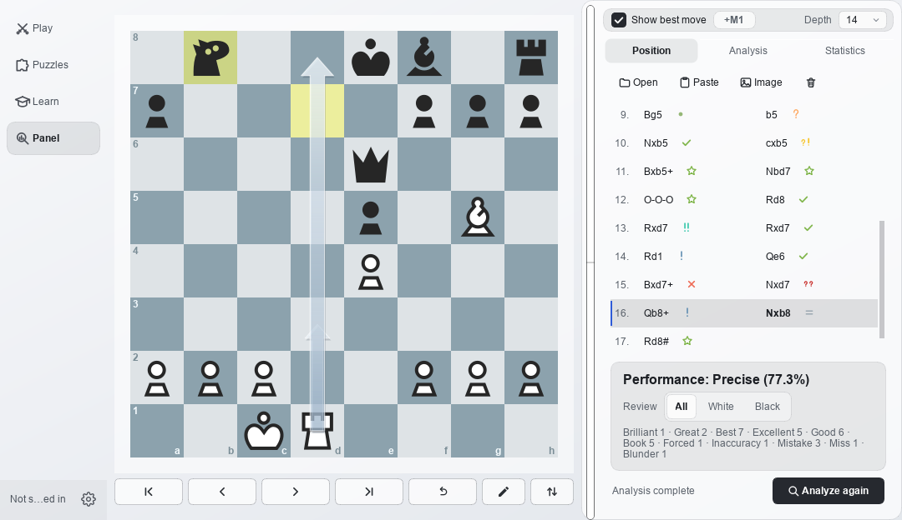
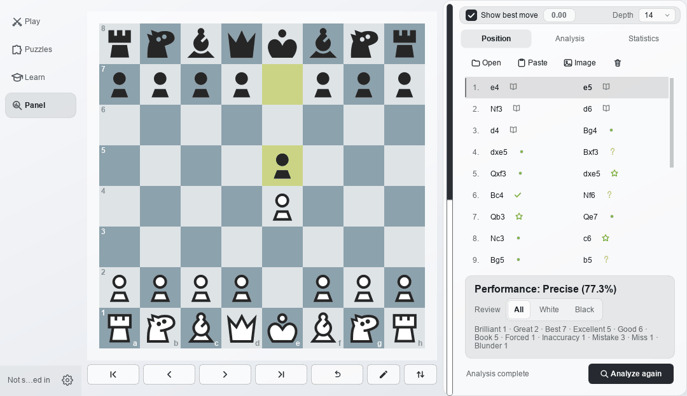
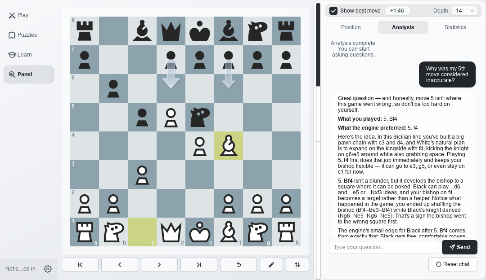
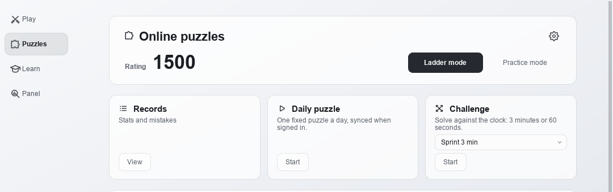
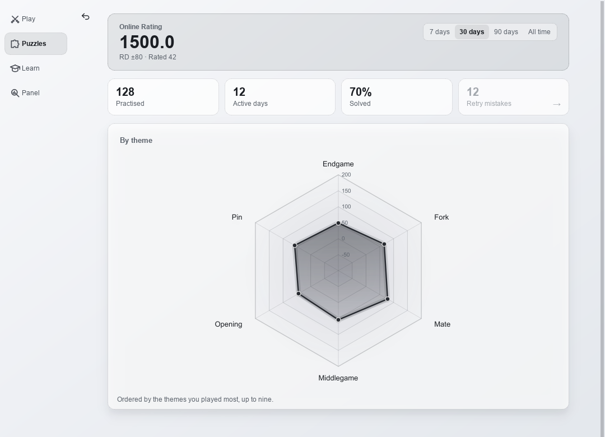
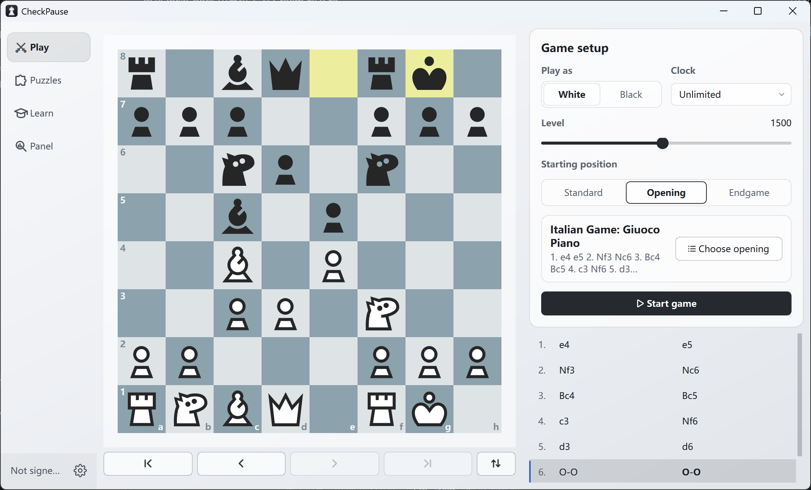
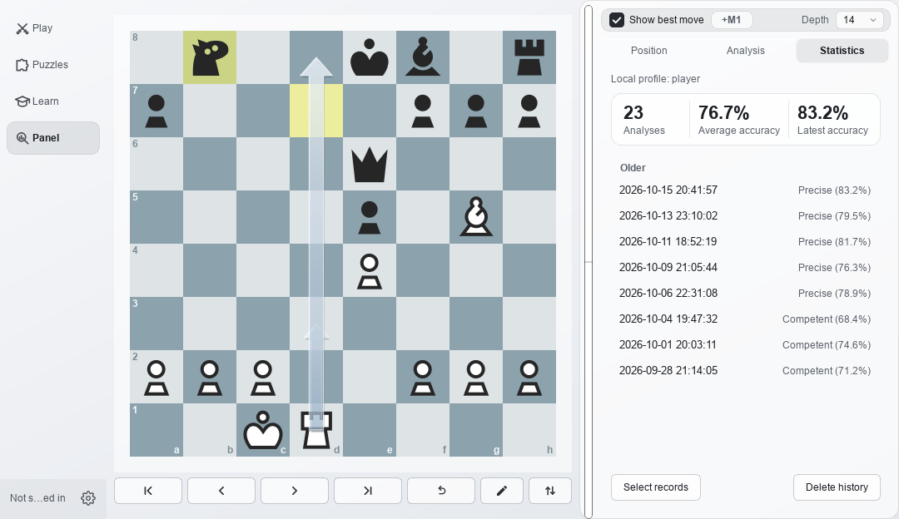
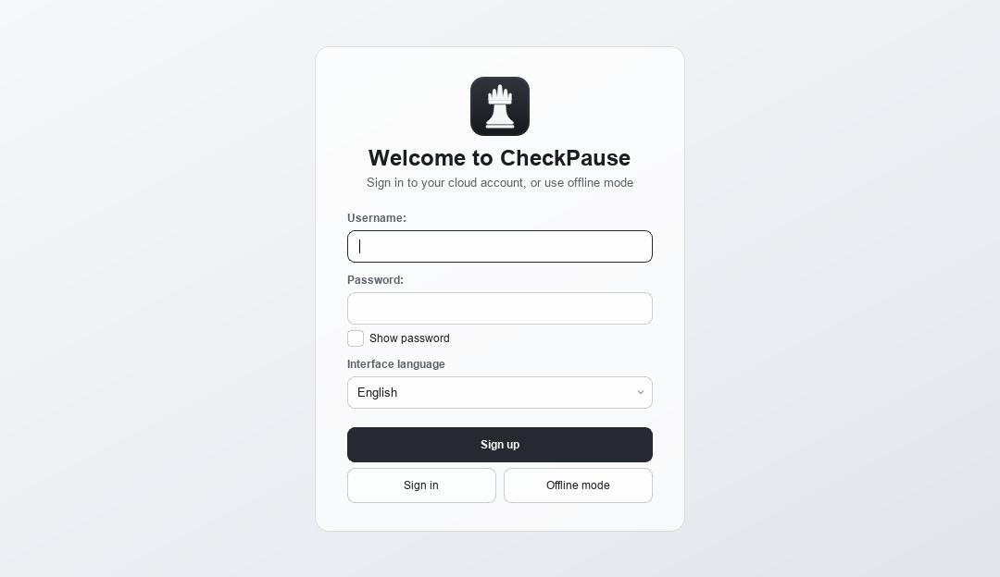

# ♟️ CheckPause

CheckPause uses Stockfish for analysis, then lets any OpenAI-compatible model translate the engine data into natural-language explanations. It also includes puzzles, lessons, and play.

---

## ✨ Features

### ♟️ Completely free analysis

- Stockfish scores every ply in the background, with a progress bar and a stop button; book moves are recognised from the bundled Polyglot opening book and skip the engine entirely.
- Judge every move — Brilliant, Great, Best, Excellent, Good, Book, Forced, Only move, Inaccuracy, Mistake, Miss, Blunder — then give the game an accuracy rating.
- Click any move to jump to that position, or use the mouse wheel to browse the game.

### 💬 Ask the engine data in plain language

- Engine data is passed to the LLM as context.
- Ask about any move: "Wasn't 10.Nxb5 just losing a knight?" — answers stay grounded in the data.
- Works with OpenAI, OpenRouter, and local models — anything that speaks the OpenAI API.

### 🧩 Train with puzzles

- With a cloud account, use online puzzles; offline, use the curated sample or import your own Lichess CSV or FEN-based PGN collections.
- Correct/wrong feedback with automatic opponent replies, hint arrows and retry; rating and themes shown per puzzle.
- A cloud account syncs your puzzle rating and mistakes.
- The Records page shows your online rating, practice history, and theme performance.

### 🎮 Play

- A 100–3000 rating slider; 1320 and above is calibrated by Stockfish's own Elo limiter, and below that Skill Level and a node budget approximate it.
- Common time controls (1+0 through 30+0, with increments or unlimited), White or Black, and selectable openings and endgames.
- Click-to-move, promotion picking, undo, resign — and a one-click send to analysis when the game ends. The setup pickers lock once a game is under way and unlock on New game.

### 🎓 Learn the basics

- Short interactive lessons on the board, grouped by topic; each step explains the idea, then asks the user to play the correct move.
- Lesson progress is saved locally, so you can continue next time.

### 📈 Records

- Total games, average accuracy, and the latest game's accuracy at a glance.
- A per-game history table with the date, the rating tier, and the percentage.

### ☁️ Optional cloud account

- Sign in to sync puzzle rating and mistakes and to use the hosted AI tier.

### 🔒 Private by design

- Local engine analysis and your API key stay on your machine. Cloud features (hosted AI, online puzzles, account sync) send only the data needed for those features to checkpause.com.

---

## 🚀 Quick Start

Requirements: Windows 10/11 (x64) or macOS 11+ (Apple Silicon or Intel). No Python needed — Stockfish, the opening book and all assets are bundled.

### Windows users

1. Get `CheckPause_Setup_2.2.1.zip` from the Download section at the end of this file, then extract it to get `CheckPause_Setup_2.2.1.exe`.
2. Run the installer and follow the prompts — no administrator rights needed, and a desktop shortcut is optional.
3. Launch CheckPause from the desktop or Start Menu; the first launch lets you sign in to a cloud account, create one, or continue offline.
4. Open the gear menu in the side rail → API settings... and fill in the API key, base URL and model name for an OpenAI-compatible endpoint (for example DeepSeek).
5. Open or paste a PGN in the Panel module, click Analyze, then ask questions on the Analysis tab.

> Analysis and board features work without an API key; only AI chat needs one.

### macOS users

1. Download the `.dmg` for your chip from the [Releases](https://github.com/Comet-zzz/CheckPause/releases) page (`M-series` for Apple Silicon, `Intel` for Intel Macs).
2. Open the `.dmg` and drag CheckPause into Applications.
3. The build is unsigned and not notarized. On first launch, **right-click the icon → Open**, or allow it under System Settings → Privacy & Security → Open Anyway.
4. From there the steps match Windows (set an API key, import a PGN, start analysis).

---

## ⚙️ Configuration and data

- The side-rail gear menu → API settings... is the bring-your-own-key path: enter the API key, base URL and model name for any OpenAI-compatible service. Signing in to a cloud account switches the app to the hosted tier instead.
- User data lives in `%APPDATA%\CheckPause\` on Windows and `~/Library/Application Support/CheckPause/` on macOS: `profile.json` (username, language, theme, appearance, history), `settings.json` (non-secret settings), and `secrets.dat` (API key and account token); legacy profiles migrate automatically.

---

## ❓ FAQ

- **Do I need an account?** No. Board analysis, play, and local puzzles work offline without an account; a cloud account adds hosted AI, online puzzles, and rating/mistake sync.
- **Do I need an API key?** Only for AI chat. Enter your own key under the side-rail gear menu → API settings..., or sign in to use the hosted tier.
- **Is my game uploaded?** Local engine analysis never leaves your machine. When you ask the AI questions, the game and engine data are sent to the model you configured; cloud features send only what they need to checkpause.com.
- **Why does Windows SmartScreen / macOS warn?** The builds are unsigned: choose More info → Run anyway on Windows, or right-click the icon → Open on macOS.

---

## 🙏 Credits

- Pieces come from Lichess open-source piece sets (cburnett, merida, chessnut, fantasy, spatial, celtic, kiwen-suwi, rhosgfx, totoy, mpchess), each owned by its author under GPLv2+ / Apache-2.0 / MIT / CC BY / CC0 licenses.
- Engine: [Stockfish](https://stockfishchess.org/) (GPLv3); the opening book is compiled from public opening lines. Puzzle data comes from the [Lichess puzzle database](https://database.lichess.org/) (CC0).
- Python libraries: python-chess (GPL-3.0+), openai (Apache-2.0), PySide6 (LGPL-3.0), numpy (BSD-3-Clause and bundled licenses), onnxruntime (MIT), cryptography (Apache-2.0 or BSD-3-Clause), python-dotenv (BSD-3-Clause). See [LICENSE](LICENSE) for the full third-party list.
- The installer is built with [Inno Setup](https://jrsoftware.org/isinfo.php) and uses its official Simplified Chinese language file (`installer/languages/ChineseSimplified.isl`, maintained by Zhenghan Yang).
- License: CheckPause is proprietary software — Copyright (C) 2026 CometZZZ, all rights reserved. See [LICENSE](LICENSE). Bundled components keep their own terms, including Stockfish (GPLv3, separate process), python-chess (GPL-3.0+), and the piece sets listed above.

---

## ⬇️ Download

**Latest: CheckPause v2.2.1 (Windows x64)**

- 🚀 **Global CDN (recommended)**: [CheckPause_Setup_2.2.1.zip](https://pub-d4ecc17f7295423188e5f8da52a4c89f.r2.dev/CheckPause_Setup_2.2.1.zip) — served from Cloudflare R2, usually much faster than the old mirror outside mainland China
- 📦 [Download from GitHub](https://github.com/Comet-zzz/CheckPause/releases/download/v2.2.1/CheckPause_Setup_2.2.1.zip) (138.9 MiB — ships with Stockfish, the opening book, piece assets, move sounds, and a curated Lichess puzzle set)
- SHA-256: `214C697EFD53BDC7A287DF484B6BBAE22D11227357434E1F2C8051A2DE861C71` (the zip; both links serve the identical file)
- **Extract the zip** to get `CheckPause_Setup_2.2.1.exe` (SHA-256 `6BC95DDFA2CF8C0478EEC54ED73693F3ABD5BB876ECA67C9F5A5ECA80211F805`), then run the installer and launch CheckPause from the desktop or Start Menu. The build is unsigned; if SmartScreen appears, choose More info → Run anyway.

**Latest: CheckPause v2.2.1 (macOS)**

- 🚀 **Global CDN (recommended)**: [M-series](https://pub-d4ecc17f7295423188e5f8da52a4c89f.r2.dev/CheckPause-2.2.1-macOS-M-series.dmg) (173.7 MiB) · [Intel](https://pub-d4ecc17f7295423188e5f8da52a4c89f.r2.dev/CheckPause-2.2.1-macOS-Intel.dmg) (100.8 MiB)
- 📦 [Download from GitHub](https://github.com/Comet-zzz/CheckPause/releases/tag/v2.2.1) (both `.dmg` files on the release page)
- SHA-256: arm64 `231A4305F7E8136EFB897EFBDF06F88D03C054A8FF3A00EA85E64DF8F7C9E7D0`, Intel `ECCDF493CB548E23E05F41AF684F19E44D8DEC0F17E70FCD6A8CA1599F8F9B74`
- Open the `.dmg`, drag CheckPause into Applications, then **right-click the icon → Open** the first time (the build is unsigned and not notarized).
- All releases: https://github.com/Comet-zzz/CheckPause/releases

---

[Chinese README](README.zh-CN.md)
