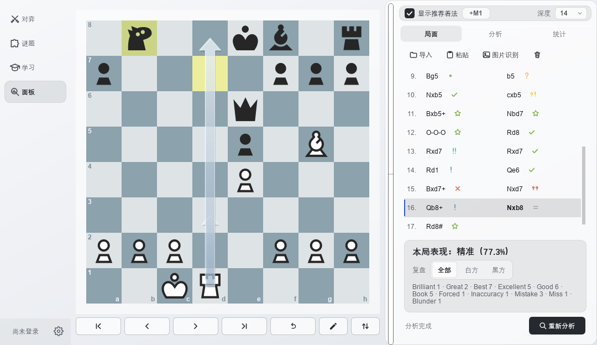
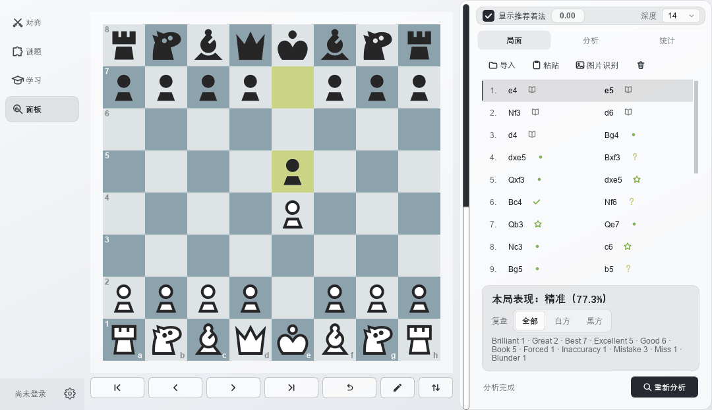
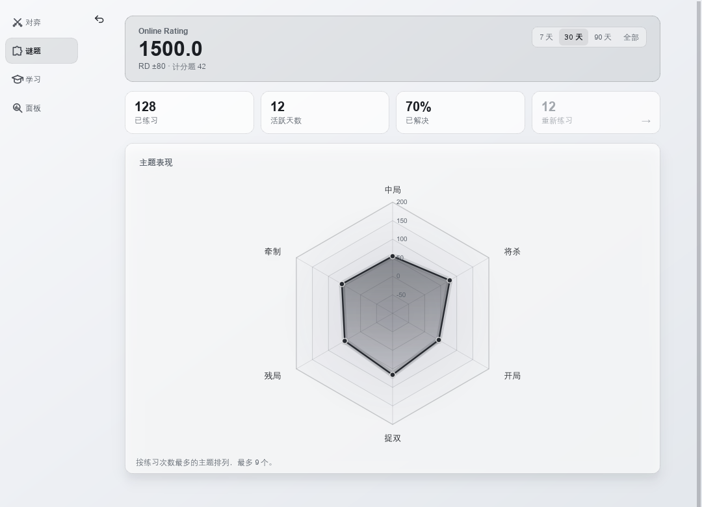
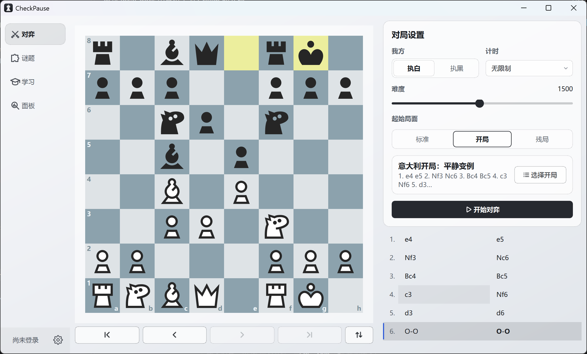
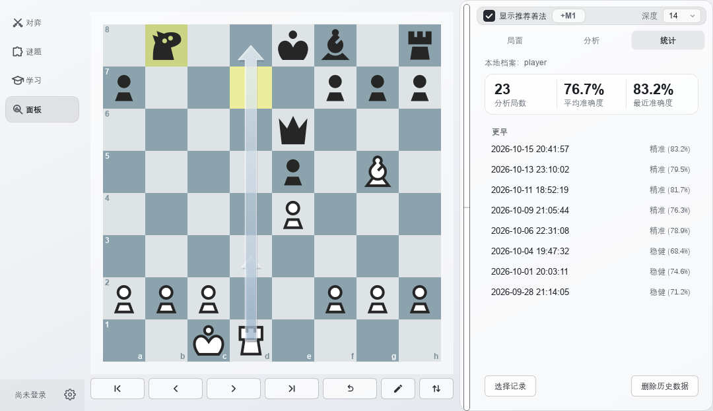
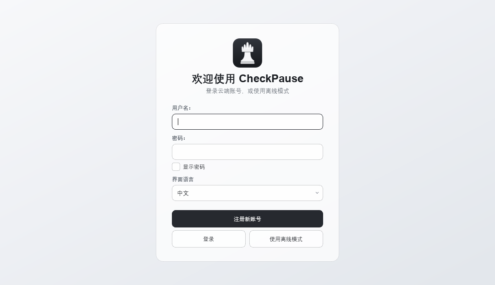

# ♟️ CheckPause

CheckPause 使用 Stockfish 进行分析，再由任意 OpenAI 兼容的大模型把引擎数据翻译成自然语言讲解；同时提供谜题、课程学习、对弈等功能。

---

## ✨ 功能特性

### ♟️ 完全免费的分析

- Stockfish 在后台逐步评分，进度条实时显示、可随时停止；内置 Polyglot 开局谱库会自动识别谱着并跳过引擎计算。
- 对每一步做出判断——精妙、绝佳、最佳、优秀、良好、谱着、被迫、唯一着、不精确、失误、漏着、严重失误——最后整盘棋给出准确度评级。
- 点击任意着法即可跳转到对应局面；也可使用鼠标滚轮浏览棋谱。

### 💬 用自然语言追问引擎数据

- 引擎数据会作为上下文交给LLM。
- 可以对任意一步提问：「10.Nxb5 不是白丢一个马吗？」——回答紧扣数据。
- 兼容 OpenAI、OpenRouter 及本地模型，只要支持 OpenAI 接口即可。

### 🧩 谜题训练

- 登录云账号后可使用在线谜题功能；离线可使用内置精选样例，或导入 Lichess CSV / 含 FEN 的 PGN 题集。
- 走对继续、走错提示，对手自动应着；支持提示箭头与重试，每题显示难度与主题。
- 云账号会同步谜题评分与错题。
- 「记录」页展示在线评分、练习统计与主题表现。

### 🎮 对弈

- 100–3000 分难度滑条；1320 分以上由引擎自带的 Elo 限制器标定，更低分数用技能等级加节点预算来近似。
- 常用计时模式（1+0 到 30+0，含加秒与无限制），可执白或执黑，可选开局与残局。
- 点击走子、升变选择、悔棋、认输——下完一键把整盘棋送入分析。对局开始后设置项自动锁定，点「新对局」即可重新调整。

### 🎓 入门课程

- 棋盘上的短互动课程，按主题分组；每一步先讲思路，再让用户走出正确着法。
- 课程进度保存在本机，下次可以继续学习。

### 📈 记录

- 总对局数、平均准确度与最近一盘准确度一目了然。
- 逐盘历史表，包含日期、评级档位与百分比。

### ☁️ 可选云账号

- 登录后可同步谜题评分与错题，并使用托管 AI 线路。

### 🔒 隐私优先

- 本地引擎分析和 API Key 只留在本机；托管 AI、在线谜题、账号同步等功能只会把对应所需的数据发送到 checkpause.com。

---

## 🚀 快速开始

系统要求：Windows 10/11（x64）或 macOS 11+（Apple Silicon 或 Intel）。无需安装 Python——Stockfish、开局库与全部资源均已内置。

### Windows 用户

1. 从文末「下载」获取 `CheckPause_Setup_2.2.1.zip`，解压后得到 `CheckPause_Setup_2.2.1.exe`；
2. 双击运行安装包，按提示完成安装（无需管理员权限，可勾选创建桌面快捷方式）；
3. 从桌面或开始菜单启动 CheckPause，首次使用可选择登录/注册云端账号，或直接进入离线模式；
4. 打开左侧栏齿轮菜单 →「API 设置...」，填写任意 OpenAI 兼容接口的 API Key、接口地址与模型名称（例如 DeepSeek）；
5. 在「面板」模块打开或粘贴 PGN，点击「开始分析」，完成后在「分析」标签页向 AI 提问。

> 没有配置 API 也能正常分析和看棋，只是 AI 对话不可用。

### macOS 用户

1. 从 [Releases](https://github.com/Comet-zzz/CheckPause/releases) 页下载对应芯片的 `.dmg`（M 系列选 `M-series`，Intel 选 `Intel`）；
2. 打开 `.dmg`，把 CheckPause 拖进「应用程序」；
3. 程序未签名/未公证，首次打开请**右键点击图标 → 打开**，或到「系统设置 → 隐私与安全性」点「仍要打开」；
4. 之后的使用步骤与 Windows 相同（设置 API Key、导入 PGN、开始分析）。

---

## ⚙️ 配置与数据

- 左侧栏齿轮菜单 →「API 设置...」是自带 Key 的本地路径：填写任意 OpenAI 兼容服务的 API Key、接口地址与模型名称；登录云端账号则切换到托管线路。
- 用户数据：Windows 在 `%APPDATA%\CheckPause\`，macOS 在 `~/Library/Application Support/CheckPause/`，内含 `profile.json`（用户名、语言、主题、外观、历史记录）、`settings.json`（非敏感设置）与 `secrets.dat`（API Key 和账号令牌），旧版一并迁移。

---

## ❓ 常见问题

- **需要账号吗？** 不需要。棋盘分析、离线对弈和本地谜题都能离线使用；云账号用于托管 AI、在线谜题以及分数/错题同步。
- **需要 API Key 吗？** 只有 AI 对话需要。在左侧栏齿轮菜单 →「API 设置...」里填自己的 Key，或登录使用托管线路。
- **棋谱会上传吗？** 本地引擎分析完全在本机进行；向 AI 提问时，棋谱与引擎数据会发送给你所配置的模型；云功能只会把对应所需的数据发送到 checkpause.com。
- **为什么 Windows / macOS 会弹安全警告？** 安装包未签名：Windows 选「更多信息 → 仍要运行」，macOS 右键点图标选「打开」即可。

---

## 🙏 致谢

- 棋子来自 Lichess 开源棋子集（cburnett、merida、chessnut、fantasy、spatial、celtic、kiwen-suwi、rhosgfx、totoy、mpchess），版权归各作者所有，遵循 GPLv2+ / Apache-2.0 / MIT / CC BY / CC0 等许可。
- 引擎为 [Stockfish](https://stockfishchess.org/)（GPLv3），开局库由公开开局线路编译；谜题数据来自 [Lichess puzzle database](https://database.lichess.org/)（CC0）。
- Python 依赖：python-chess（GPL-3.0+）、openai（Apache-2.0）、PySide6（LGPL-3.0）、numpy（BSD-3-Clause 及随附许可）、onnxruntime（MIT）、cryptography（Apache-2.0 或 BSD-3-Clause）、python-dotenv（BSD-3-Clause）。完整第三方清单见 [LICENSE](LICENSE)。
- 安装包由 [Inno Setup](https://jrsoftware.org/isinfo.php) 生成，并使用其官方简体中文语言包（`installer/languages/ChineseSimplified.isl`，维护者 Zhenghan Yang）。
- 许可：CheckPause 为**专有软件**，版权所有 (C) 2026 CometZZZ，保留所有权利，详见 [LICENSE](LICENSE)。内置组件沿用各自原有许可——Stockfish 为 GPLv3（源码可从 https://stockfishchess.org/download/ 获取），python-chess 为 GPL-3.0+，棋子集遵循上述各自许可。

---

## ⬇️ 下载

**最新版：CheckPause v2.2.1（Windows x64）**

- 🚀 **全球 CDN（推荐）**：[CheckPause_Setup_2.2.1.zip](https://pub-d4ecc17f7295423188e5f8da52a4c89f.r2.dev/CheckPause_Setup_2.2.1.zip) — 托管在 Cloudflare R2，海外和代理网络通常比旧镜像快很多
- 📦 [GitHub 下载](https://github.com/Comet-zzz/CheckPause/releases/download/v2.2.1/CheckPause_Setup_2.2.1.zip)（138.9 MiB，已内置 Stockfish、开局库、棋子资源、走棋音效与 Lichess 精选题集）
- SHA-256：`214C697EFD53BDC7A287DF484B6BBAE22D11227357434E1F2C8051A2DE861C71`（压缩包；两个链接是同一个文件，哈希一致）
- **解压压缩包**，得到 `CheckPause_Setup_2.2.1.exe`（其 SHA-256 为 `6BC95DDFA2CF8C0478EEC54ED73693F3ABD5BB876ECA67C9F5A5ECA80211F805`），双击运行安装包即可，安装后从桌面或开始菜单启动；程序未签名，若 Windows SmartScreen 提示，请选择「更多信息 → 仍要运行」。

**macOS 最新版：CheckPause v2.2.1**

- 🚀 **全球 CDN（推荐）**：[M 系列](https://pub-d4ecc17f7295423188e5f8da52a4c89f.r2.dev/CheckPause-2.2.1-macOS-M-series.dmg)（173.7 MiB）｜[Intel](https://pub-d4ecc17f7295423188e5f8da52a4c89f.r2.dev/CheckPause-2.2.1-macOS-Intel.dmg)（100.8 MiB）
- 📦 [GitHub 下载](https://github.com/Comet-zzz/CheckPause/releases/tag/v2.2.1)（发布页上有两个 `.dmg`）
- SHA-256：Apple Silicon `231A4305F7E8136EFB897EFBDF06F88D03C054A8FF3A00EA85E64DF8F7C9E7D0`，Intel `ECCDF493CB548E23E05F41AF684F19E44D8DEC0F17E70FCD6A8CA1599F8F9B74`
- 打开 `.dmg`，把 CheckPause 拖进「应用程序」，首次打开请**右键点击图标 → 打开**（程序未签名、未公证）。
- 全部版本：https://github.com/Comet-zzz/CheckPause/releases

---

[English README](README.md)
