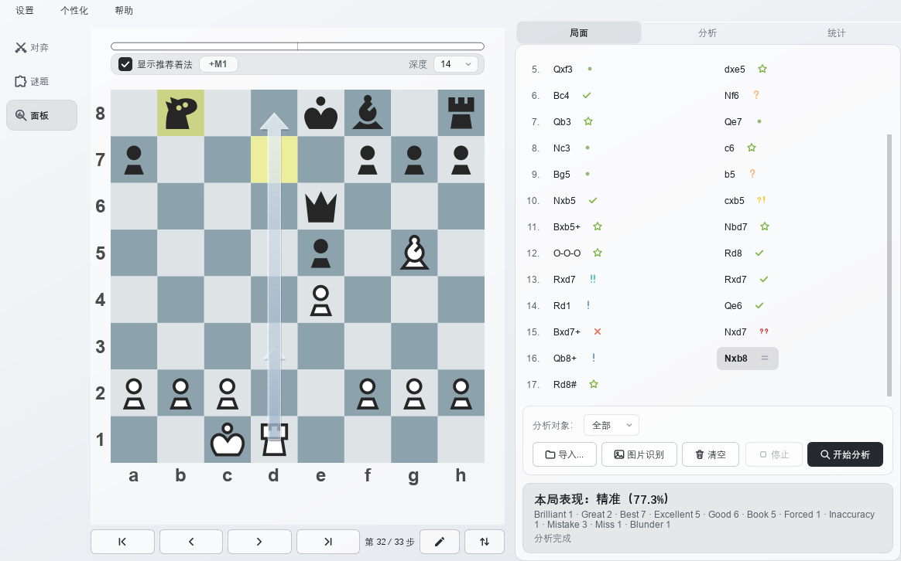
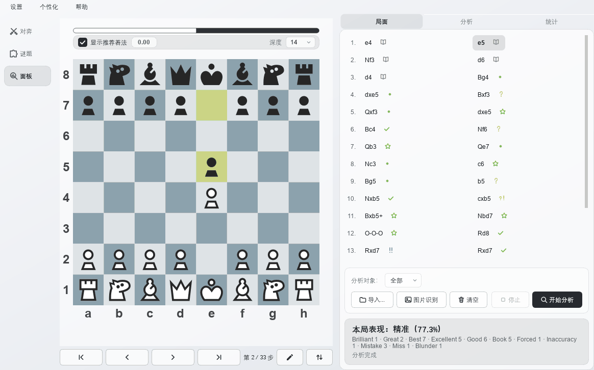
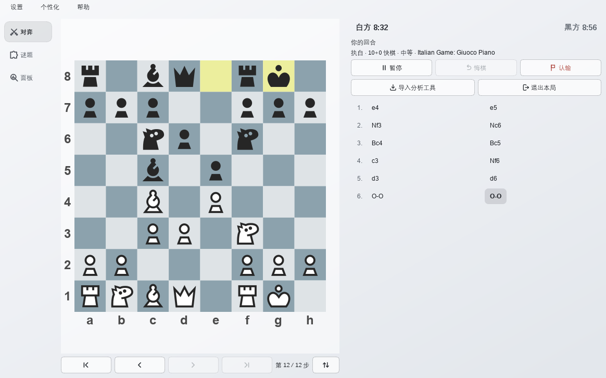
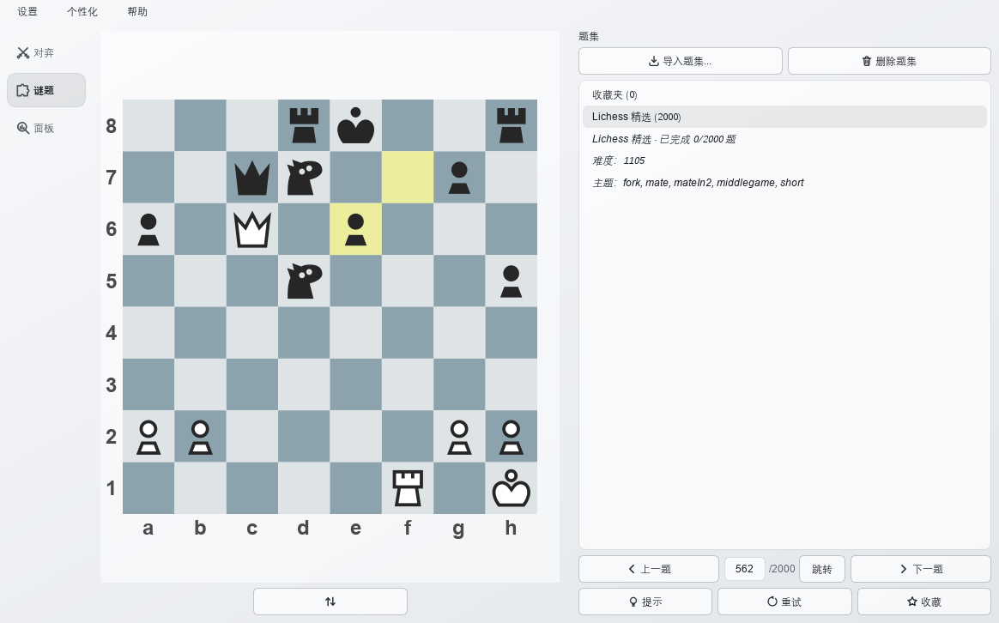
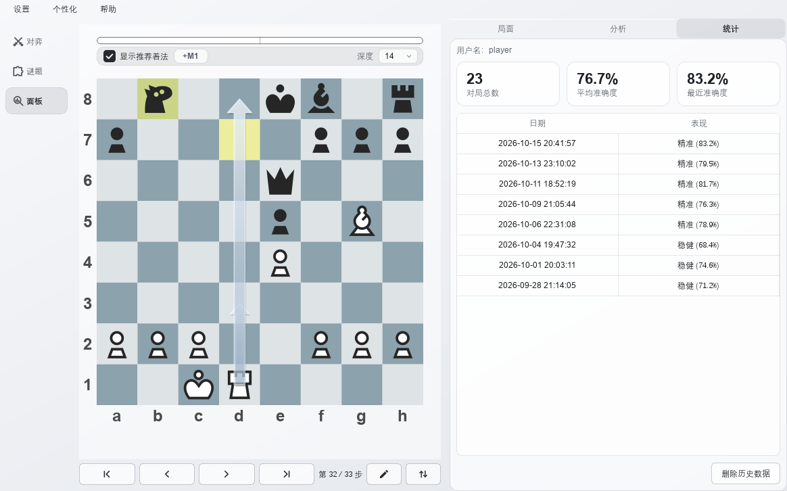
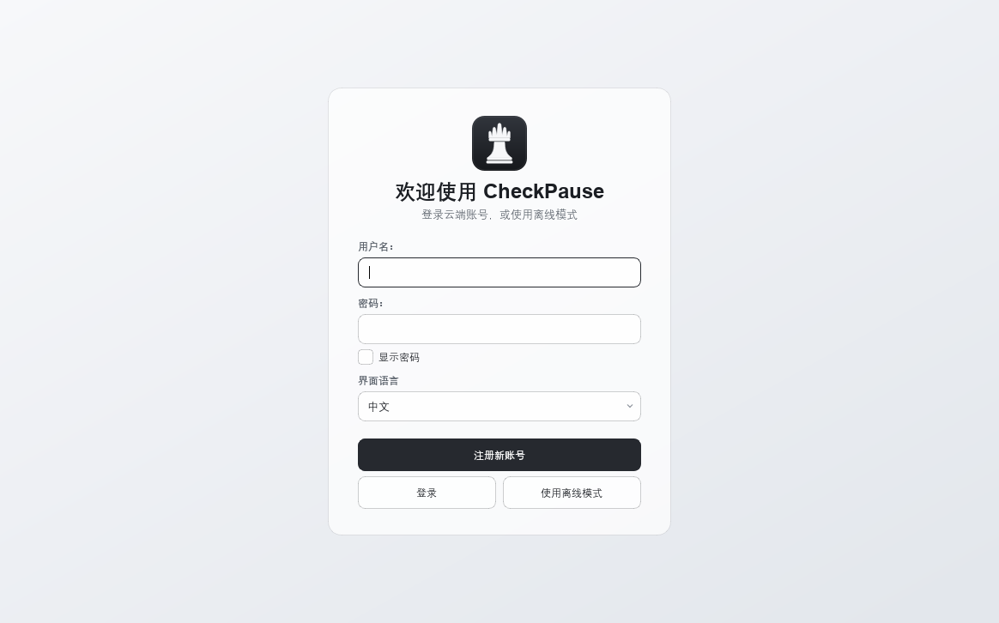

# ♟️ CheckPause

将博弈树搜索与自然语言生成相结合的国际象棋分析工具，帮助棋手理解自己的决策偏差。

CheckPause 使用本地 Stockfish 评估每一步，再由任意 OpenAI 兼容的大模型把引擎数据翻译成自然语言讲解，并配有可点击的着法列表、自绘棋盘、表现评级与成长档案。

---

## ✨ 功能特性

### ♟️ 逐手复盘，像一份棋局报告

- Stockfish 在后台逐步评分，进度条实时显示、可随时停止；内置 Polyglot 开局谱库会自动识别谱着并跳过引擎计算。
- 每一步都有评语——精妙、绝佳、最佳、优秀、良好、谱着、被迫、唯一着、不精确、失误、漏着、严重失误——整盘棋给出五档准确度评级（卓越 / 精准 / 稳健 / 平均 / 欠考虑）。
- 点击任意着法即可跳转到对应局面；棋盘会画出引擎推荐着法箭头、显示实时评估条，一键翻转棋盘。

### 💬 用自然语言追问引擎数据

- 引擎数据（PGN 与每手评分、最佳着法）会作为上下文交给大模型，回答逐字流式输出。
- 追问像和教练对话：「10.Nxb5 不是白丢一个马吗？」——回答紧扣屏幕上的数据。
- 兼容 DeepSeek、OpenAI、OpenRouter 及本地模型，只要支持 OpenAI 接口即可。

### 🎮 人机对弈

- 100–3000 分难度滑条；1320 分以上由引擎自带的 Elo 限制器标定，更低分数用技能等级加节点预算来近似。
- 常用计时模式（1+0 到 30+0，含加秒与无限制），可执白或执黑，可选开局与残局。
- 点击走子、升变选择、悔棋、认输——下完一键把整盘棋送入分析。对局开始后设置项自动锁定，点「新对局」即可重新调整。

### 🧩 谜题训练

- 内置一份 Lichess 精选样例，也可导入自己的开源题集（Lichess CSV、含 FEN 的 PGN）；大题库按需惰性读取。
- 走对继续、走错提示，对手自动应着；支持提示箭头与重试，每题显示难度与主题。
- 「收藏夹」会自动收录你点过「收藏」或答错的题目。

### 📈 记录成长

- 总对局数、平均准确度与最近一盘准确度一目了然。
- 逐盘历史表，包含日期、评级档位与百分比。

### 🎨 个性化

- 10 套 Lichess 开源棋子、6 种棋盘配色、明暗主题，选择即时生效并持久化。
- 走棋音效覆盖普通走子、吃子、将军、易位与升变，「默认」或「关闭」可选；音效全部由项目自行合成，不含第三方素材。
- 中英文界面随时切换；「个性化」里可调分析深度（12–18）与评估深度（10–22）。

### 🔒 隐私优先

- 棋谱与 API Key 只保存在本机，分析不依赖云端。

---

## 🚀 快速开始

系统要求：Windows 10/11（x64）或 macOS 11+（Apple Silicon 或 Intel）。无需安装 Python——Stockfish、开局库与全部资源均已内置。

### Windows 用户

1. 从文末「下载」获取 `CheckPause_Setup_2.0.4.zip`，解压后得到 `CheckPause_Setup_2.0.4.exe`；
2. 双击运行安装包，按提示完成安装（无需管理员权限，可勾选创建桌面快捷方式）；
3. 从桌面或开始菜单启动 CheckPause，首次使用可选择登录/注册云端账号，或直接进入离线模式；
4. 打开「设置 → API 设置...」，填写任意 OpenAI 兼容接口的 API Key、接口地址与模型名称（例如 DeepSeek）；
5. 在「导入」页粘贴 PGN 或打开文件，点击「开始分析」，完成后切到「分析」页向 AI 提问。

> 没有配置 API 也能正常分析和看棋，只是 AI 对话不可用。

### macOS 用户

1. 从 [Releases](https://github.com/Comet-zzz/CheckPause/releases) 页下载对应芯片的 `.dmg`（M 系列选 `M-series`，Intel 选 `Intel`）；
2. 打开 `.dmg`，把 CheckPause 拖进「应用程序」；
3. 程序未签名/未公证，首次打开请**右键点击图标 → 打开**，或到「系统设置 → 隐私与安全性」点「仍要打开」；
4. 之后的使用步骤与 Windows 相同（设置 API Key、导入 PGN、开始分析）。

---

## ⚙️ 配置与数据

- 「设置 → API 设置...」是自带 Key 的本地路径：填写任意 OpenAI 兼容服务的 API Key、接口地址与模型名称；登录云端账号则切换到托管线路。
- 用户数据：Windows 在 `%APPDATA%\CheckPause\`，macOS 在 `~/Library/Application Support/CheckPause/`，内含 `profile.json`（用户名、语言、主题、外观、历史记录）与 `settings.json`（API 配置），旧版一并迁移。

---

## ❓ 常见问题

- **需要账号吗？** 不需要。棋盘、引擎分析、对弈与谜题都能离线使用；云端账号只用于解锁托管 AI 线路。
- **需要 API Key 吗？** 只有 AI 对话需要。在「设置 → API 设置...」里填自己的 Key，或登录使用托管线路。
- **棋谱会上传吗？** 本地引擎分析完全在本机进行；向 AI 提问时，棋谱与引擎数据会发送给你所配置的模型（使用托管线路时同理）。
- **为什么 Windows / macOS 会弹安全警告？** 安装包未签名：Windows 选「更多信息 → 仍要运行」，macOS 右键点图标选「打开」即可。

---

## 🙏 致谢

- 棋子来自 Lichess 开源棋子集（cburnett、merida、chessnut、fantasy、spatial、celtic、kiwen-suwi、rhosgfx、totoy、mpchess），版权归各作者所有，遵循 GPLv2+ / Apache-2.0 / MIT / CC BY / CC0 等许可。
- 引擎为 [Stockfish](https://stockfishchess.org/)（GPLv3），开局库由公开开局线路编译。
- 安装包由 [Inno Setup](https://jrsoftware.org/isinfo.php) 生成，并使用其官方简体中文语言包（`installer/languages/ChineseSimplified.isl`，维护者 Zhenghan Yang）。
- 许可：CheckPause 为**专有软件**，版权所有 (C) 2026 CometZZZ，保留所有权利，详见 [LICENSE](LICENSE)。内置组件沿用各自原有许可——Stockfish 为 GPLv3（源码可从 https://stockfishchess.org/download/ 获取），棋子集遵循上述各自许可。

---

## ⬇️ 下载

**最新版：CheckPause v2.0.4（Windows x64）**

- 🚀 **国内加速下载（推荐）**：[CheckPause_Setup_2.0.4.zip](https://checkpause.com/download/CheckPause_Setup_2.0.4.zip) — 同一份文件放在国内能稳定连上的服务器上，通常几十秒下完
- 📦 [GitHub 下载](https://github.com/Comet-zzz/CheckPause/releases/download/v2.0.4/CheckPause_Setup_2.0.4.zip)（136.3 MB，已内置 Stockfish、开局库、棋子资源、走棋音效与 Lichess 精选题集）
- SHA-256：`3F246F33C97C05A9348120378C238134A4BB17051F444A1D07CACED4DC8985C7`（压缩包；两个链接是同一个文件，哈希一致）
- **解压压缩包**，得到 `CheckPause_Setup_2.0.4.exe`（其 SHA-256 为 `4DB34A6BDCFC876CC7CBCD48A65895DB6E1277F74B1B41187EFD9404B011BF6E`），双击运行安装包即可，安装后从桌面或开始菜单启动；程序未签名，若 Windows SmartScreen 提示，请选择「更多信息 → 仍要运行」。

**macOS 最新版：CheckPause v2.0.4**

- 🚀 **国内加速下载（推荐）**：[M 系列](https://checkpause.com/download/CheckPause-2.0.4-macOS-M-series.dmg)（167.1 MB）｜[Intel](https://checkpause.com/download/CheckPause-2.0.4-macOS-Intel.dmg)（95.7 MB）
- 📦 [GitHub 下载](https://github.com/Comet-zzz/CheckPause/releases/tag/v2.0.4)（发布页上有两个 `.dmg`）
- SHA-256：Apple Silicon `CE0766900AE83133F19779C9E9EA61813EB25CC34C97817B09C8AFC31BBFD060`，Intel `FB07C08F5D63E15BE0A6DF0BD502AEF2A2AE9A1F2215593A4B019DE992FFEEFF`
- 打开 `.dmg`，把 CheckPause 拖进「应用程序」，首次打开请**右键点击图标 → 打开**（程序未签名、未公证）。
- 全部版本：https://github.com/Comet-zzz/CheckPause/releases

---

[English README](README.md)
